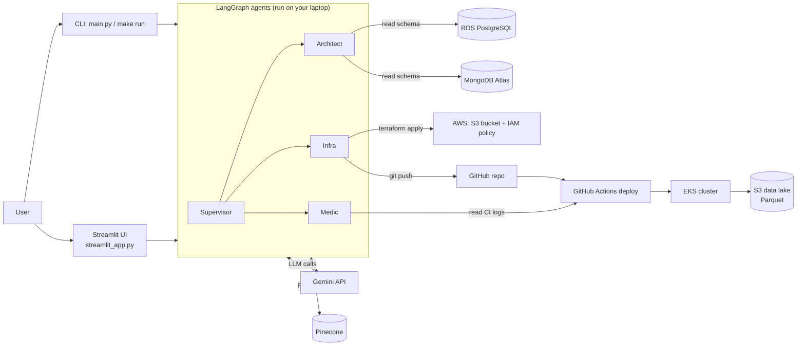
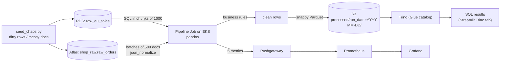
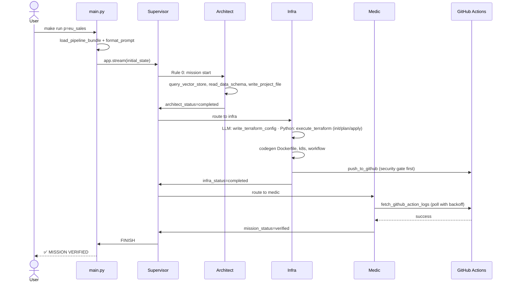
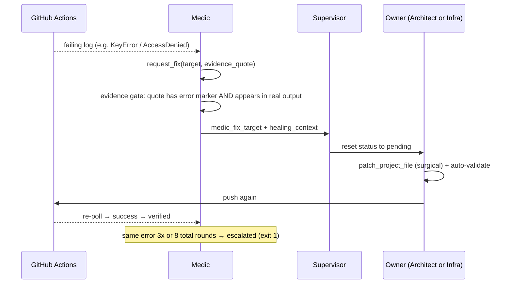
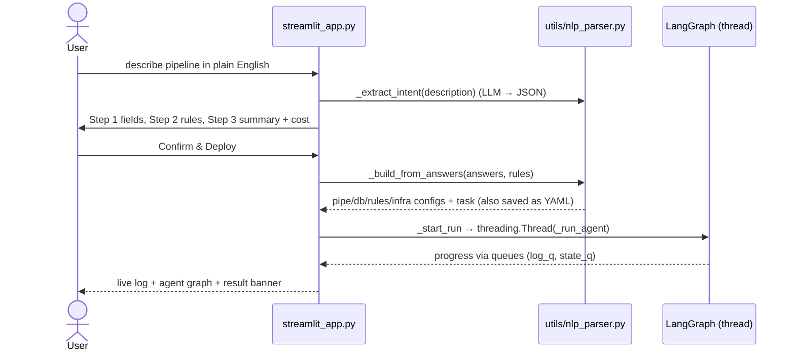
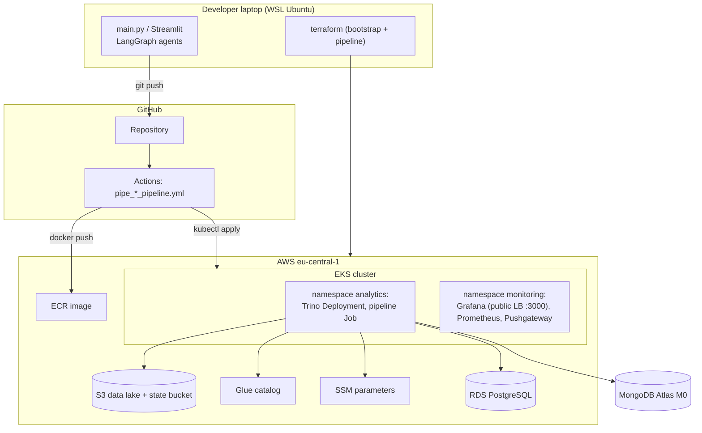
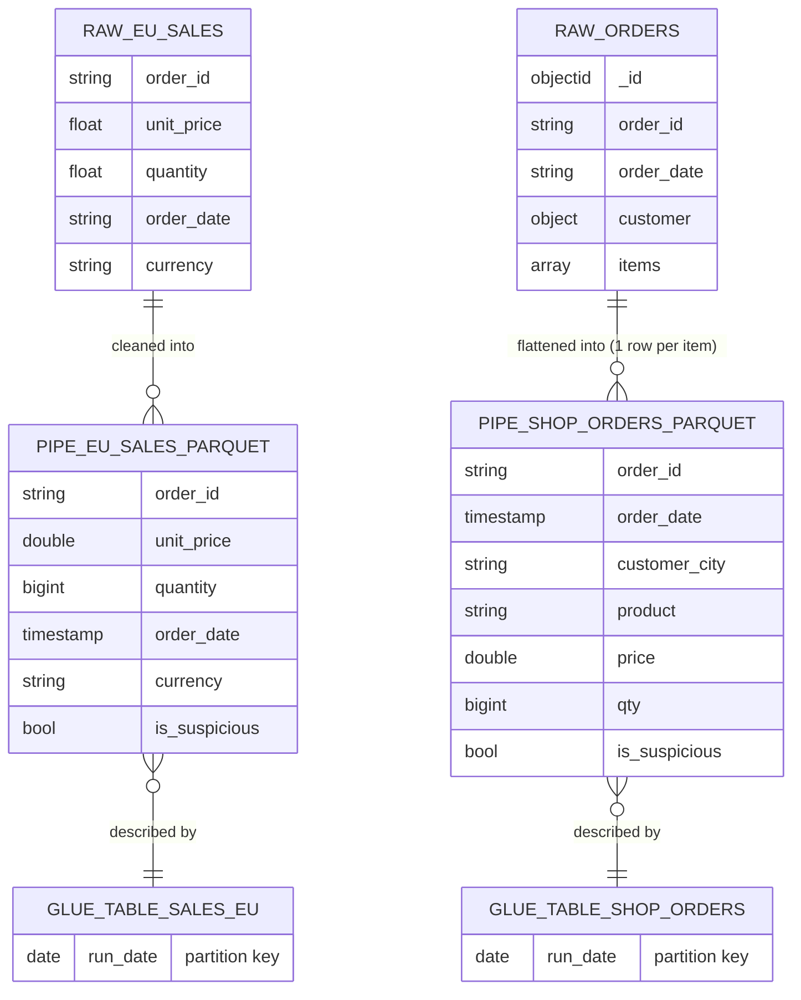

# PROJECT GUIDE — Self-Healing Big Data Pipeline on AWS

> A learning guide and viva preparation document. Everything here was checked against the source
> code in this repository (branch `feat/slim-down-mini-project`). Where something is simulated,
> optional, or was fixed by hand, it is said explicitly. No secrets are included.

**How to use this guide:** read §1–§4 first (what it is and how it works), then §5–§9 (files,
data, APIs, concepts, code), then practise with §10–§12. If you only have 15 minutes, read §13.

---

## 1. Project Overview

### 1.1 Title
**Self-Healing Big Data Pipeline on AWS** — a multi-agent AI system that builds, deploys and
repairs batch data pipelines.

### 1.2 Problem statement
Building a data pipeline is many separate jobs: extraction code, cleaning rules, a storage
layout, a SQL catalog, cloud infrastructure, containers, CI/CD, and monitoring. When the pipeline
fails (dirty data, a wrong config value, a missing permission), an engineer has to read the logs,
find the faulty file, fix it and redeploy. That is slow and repetitive.

### 1.3 What the project does
You give it a pipeline definition (a YAML file, or a plain-English description in the web UI).
Four AI agents then:
1. **design** the ETL script and the SQL table definition,
2. **provision** the cloud resources with Terraform and **deploy** everything through GitHub Actions to Kubernetes on AWS,
3. **watch** the deployment, and if it fails, **diagnose** the error from the real CI logs and **fix** the exact file, then redeploy.

The deployed pipeline reads raw data (PostgreSQL table or MongoDB documents), applies
data-quality rules, writes **Parquet files partitioned by `run_date`** into an **S3 data lake**,
registers them in **Trino** for SQL, and pushes metrics to **Prometheus/Grafana**.

### 1.4 Why it was developed
To show two things in one mini project:
- **Big Data engineering**: ingestion, cleansing, columnar storage, partitioning, schema-on-read SQL, observability, two data varieties (structured + semi-structured).
- **Automation with AI agents**: an LLM-based system that does the repetitive engineering work and *repairs itself* with evidence, instead of guessing.

### 1.5 Target users
Data engineers / analytics teams who need repeatable pipelines, and (for this project) students
and examiners who want to see a complete, real cloud data pipeline end-to-end.

### 1.6 Important features (all implemented and run on real AWS on 1 Nov 2026)
| Feature | Where |
|---|---|
| Two pipelines: `eu_sales` (PostgreSQL → S3) and `shop_orders` (MongoDB → S3) | `configs/pipelines/` |
| Multi-agent workflow: Supervisor, Architect, Infra, Medic | `graph.py`, `agents/` |
| Evidence-based self-healing (bounded: 3 identical / 8 total fix rounds) | `agents/medic.py` |
| RAG over engineering standards (Pinecone) | `knowledge_base/`, `agents/tools.py::query_vector_store` |
| Deterministic code generation for Dockerfile, K8s, CI workflow, dashboard | `agents/codegen.py` |
| Data-quality rules (drop / exclude / default / flag) | `configs/business_rules/*.yaml` |
| Parquet + `run_date` partitions + Trino (Glue metastore) | generated `scripts/`, `sql/` |
| Observability: Pushgateway → Prometheus → Grafana | generated `k8s/`, `dashboards/` |
| Pre-push security gate | `policy/security_analyzer.py` |
| Streamlit web UI | `streamlit_app.py` |
| Chaos data generator (dirty rows / messy documents) | `scripts/seed_chaos.py` |
| Offline evaluation of the Medic (12 failure cases, 100%) | `evals/` |
| 235 automated tests | `tests/` |

### 1.7 Overall working in simple words
Think of a small engineering team. The **Supervisor** is the team lead who decides who works
next. The **Architect** writes the data-processing code. The **Infra** engineer builds the cloud
setup and ships it. The **Medic** is the on-call engineer who reads the failure logs and tells the
right person exactly what to fix. They all read the same "company rulebook" (the knowledge base)
before working.

### 1.8 The 1-minute answer to "Explain your project"
> "Our project is a self-healing Big Data pipeline on AWS. A team of four AI agents, built with
> LangGraph, takes a pipeline definition and builds everything automatically: the Python ETL
> script, the Trino table, the Terraform infrastructure, the Docker image, Kubernetes manifests
> and the GitHub Actions deployment. The deployed pipeline reads raw data from PostgreSQL or
> MongoDB, applies data-quality rules, writes Parquet files partitioned by date into an S3 data
> lake, makes them queryable with SQL through Trino, and shows metrics in Grafana. If the
> deployment fails, a Medic agent reads the real CI logs, quotes the exact error, and routes a fix
> to the right agent, which patches the file and redeploys. We ran both pipelines on real AWS:
> 100 dirty sales rows became 68 clean rows, and 500 nested MongoDB orders became 644 clean
> item rows."

---

## 2. Complete Technology Stack

### 2.1 Summary table (only technologies actually used in the code)
| Technology | Purpose in project | Why we used it | Where it is used |
|---|---|---|---|
| **Python 3.12+** | Whole system: agents, tools, ETL scripts, UI | Data ecosystem (pandas, pyarrow), AI libraries | everywhere (`pyproject.toml`: `requires-python >=3.12`) |
| **LangGraph** | State machine connecting the 4 agents | Explicit nodes + conditional edges, shared state | `graph.py` |
| **LangChain (core, openai, google-genai)** | Chat models, tool binding, embeddings | One interface for Gemini and OpenAI | `agents/llm_factory.py`, `utils/llm_defaults.py` |
| **Google Gemini API** (default) | LLM for agents + embeddings | Free tier | `LLM_PROVIDER=gemini` |
| **OpenAI API** (optional) | Alternative LLM/embeddings | Same code path, paid | `LLM_PROVIDER=openai` |
| **Pinecone** | Vector database for RAG | Managed, free starter, simple API | `agents/tools.py`, `scripts/ingest_to_pinecone.py` |
| **pandas** | ETL transformations in generated scripts | Standard DataFrame tool | `scripts/pipe_*.py` |
| **PyArrow + s3fs** | Write Parquet (snappy) to S3 | Columnar format for analytics | `chunk.to_parquet(...)` |
| **SQLAlchemy + psycopg2** | Connect to PostgreSQL | Standard DB access | `scripts/pipe_eu_sales_to_s3.py`, `tools.read_data_schema` |
| **pymongo** | Connect to MongoDB Atlas | Official MongoDB driver | `scripts/pipe_shop_orders_to_s3.py`, `utils/mongo_schema.py` |
| **PostgreSQL (Amazon RDS)** | Structured source (`raw_eu_sales`) | Typical OLTP source | `bootstrap/aws/rds.tf` |
| **MongoDB Atlas (M0 free)** | Semi-structured source (`shop_raw.raw_orders`) | Shows data *variety* | `configs/databases/mongo_shop.yaml` |
| **Amazon S3** | Data lake (Parquet) + Terraform state | Cheap, durable object storage | generated `terraform/main.tf` |
| **AWS Glue Data Catalog** | Table metadata for Trino (Hive metastore) | Managed metastore, no extra DB | `k8s/configmaps.yaml`: `hive.metastore=glue` |
| **Trino** | SQL engine over Parquet in S3 | Schema-on-read, partition pruning | `k8s/trino_deployment.yaml`, `sql/setup_trino.sql` |
| **Prometheus + Pushgateway** | Store pipeline metrics | Batch jobs push metrics then exit | `k8s/prometheus_deployment.yaml` |
| **Grafana** | Dashboard (5 panels) | Standard metrics UI | `k8s/grafana_deployment.yaml`, `dashboards/monitoring_specs.json` |
| **Amazon EKS (Kubernetes, Auto Mode)** | Runs Trino, Grafana, Prometheus, pipeline Job | Container orchestration | `bootstrap/aws/eks.tf` |
| **Docker + Amazon ECR** | Package the pipeline script as an image | Same environment everywhere | `Dockerfile`, `aws_ecr_repository.pipeline` |
| **Terraform** | Infrastructure as code (bootstrap + per-pipeline) | Reproducible, reversible infra | `bootstrap/aws/`, generated `terraform/` |
| **GitHub Actions** | CI/CD: build, push, deploy; tests | Integrated with the repo | `.github/workflows/` |
| **AWS SSM Parameter Store** | Credentials (SecureString) for pipelines | No passwords in code | `bootstrap/aws/ssm.tf`, `utils/cloud_config.py` |
| **IAM + IRSA** | Pods get AWS permissions without keys | Least privilege, no static keys in pods | `bootstrap/aws/iam.tf` |
| **DynamoDB** | Terraform state lock | Prevent two applies at once | `aws_dynamodb_table.tf_lock` |
| **Streamlit** | Web UI | Fast Python-only UI | `streamlit_app.py` |
| **pydantic** | Validate the parsed pipeline intent | Typed validation | `utils/nlp_parser.py::PipelineIntent` |
| **Faker / numpy** | Generate dirty demo data | Realistic fake data | `scripts/seed_chaos.py` |
| **pytest, ruff, uv** | Tests, lint, dependency management | Fast, standard | `tests/`, `pyproject.toml`, `uv.lock` |

### 2.2 The major technologies explained (what / problem / why / where / talks to / alternatives)

**LangGraph** — *What:* a library to build a program as a graph of "nodes" that share one state
object. *Problem:* coordinating several AI agents without spaghetti code. *Why:* conditional
edges let Python decide routing deterministically. *Where:* `graph.py` registers the nodes
`supervisor`, `architect`, `infra`, `medic`, `execute_tools`. *Talks to:* each node is a Python
function that calls the LLM and tools. *Alternatives:* CrewAI, AutoGen, a hand-written loop.

**Gemini / OpenAI (LLM)** — *What:* large language models used through an API. *Problem:*
generating code and diagnosing errors needs judgement. *Why Gemini:* free tier for a student
project; OpenAI kept as a switch. *Where:* `agents/llm_factory.py::get_llm()`; each agent starts on its
own Gemini model and falls back through the other free models (`flash-lite` last) because the free
tier allows ~20 requests/day per model. *Alternatives:* Claude (also supported in code), local models.

**Pinecone (vector database) + RAG** — *What:* stores text as vectors (embeddings) so you can
search by meaning. *Problem:* the LLM must follow *our* engineering rules, not invent its own.
*Why:* managed and free. *Where:* `scripts/ingest_to_pinecone.py` uploads each
`knowledge_base/*.md` file as one vector (namespace `engineering-standards`);
`tools.query_vector_store` searches it; `store_architectural_insight` saves successful fixes in
namespace `dynamic-experience`. *Alternatives:* pgvector, Chroma, FAISS, MongoDB Atlas Vector Search.

**S3 + Parquet + partitioning** — *What:* S3 is object storage; Parquet is a columnar file format;
partitioning puts each day's data in its own folder `run_date=YYYY-MM-DD/`. *Problem:* analytics
over large data must be cheap and fast. *Why:* columnar + compressed (snappy) files are small and
let engines read only needed columns; partitions let queries skip whole days. *Where:* generated
`scripts/pipe_*.py` → `to_parquet(f"{partition_uri}part_{i}.parquet", compression="snappy")`.
*Alternatives:* CSV (row-based, larger), Delta Lake/Iceberg (table formats with transactions).

**Trino + Glue** — *What:* Trino is a distributed SQL query engine; Glue stores table metadata.
*Problem:* you want SQL on files without loading them into a database. *Why:* schema-on-read:
the table is just a description pointing at `s3://.../processed/`. *Where:* `sql/setup_trino.sql`
(`CREATE TABLE ... WITH (format='PARQUET', external_location=..., partitioned_by=ARRAY['run_date'])`),
run by the Job's init container; the script calls `CALL hive.system.sync_partition_metadata(...)`.
*Alternatives:* Amazon Athena (managed Trino), Spark SQL, Redshift Spectrum.

**Prometheus + Pushgateway + Grafana** — *What:* metrics database, a "mailbox" for short jobs,
and a dashboard tool. *Problem:* a batch job exits before Prometheus can scrape it. *Why:* the job
*pushes* 5 metrics to the Pushgateway; Prometheus scrapes the gateway; Grafana queries Prometheus.
*Where:* end of each generated script (`push_to_gateway(...)`), `k8s/prometheus_deployment.yaml`,
`dashboards/monitoring_specs.json`. *Alternatives:* CloudWatch, Datadog.

**Kubernetes (EKS) + Docker + ECR** — *What:* Docker packages the script; ECR stores the image;
Kubernetes runs it as a `Job` next to long-running `Deployment`s (Trino, Grafana, Prometheus).
*Why:* the same image runs identically everywhere; K8s restarts and schedules containers.
*Where:* `Dockerfile`, `k8s/*.yaml`, deploy workflow. *Alternatives:* AWS Batch, ECS, Lambda.

**Terraform** — *What:* infrastructure as code. *Problem:* clicking in the console is not
repeatable. *Why:* declarative, has a plan step, can destroy everything. *Where:* `bootstrap/aws/`
(one-time base: EKS, RDS, ECR, IAM, SSM, state bucket, lock table) and the agent-generated
`terraform/` (per pipeline: data bucket, encryption, versioning, lifecycle, IAM policy).
*Alternatives:* AWS CloudFormation, CDK, Pulumi.

**GitHub Actions** — *What:* CI/CD in the repo. *Why:* the agent only has to `git push`; the
generated workflow `.github/workflows/pipe_<id>_pipeline.yml` builds, pushes and deploys.
`tests.yml` runs lint, tests, eval check, security gate. *Alternatives:* Jenkins, GitLab CI, CodePipeline.

**Streamlit** — *What:* a Python library that turns a script into a web app. *Why:* no separate
frontend/backend needed for a student project. *Where:* `streamlit_app.py`. *Important:* there is
**no separate REST backend**; Streamlit calls the Python functions directly (see §7).
*Alternatives:* React + FastAPI, Flask.

### 2.3 Not used / important honesty notes
- **No user login/authentication** exists in the app (it is a local single-user tool). Security is about *cloud credentials*, not user accounts.
- **No REST API is exposed by this project.** It *consumes* external APIs (Gemini, Pinecone, GitHub, AWS, Trino, Prometheus).
- Azure/GCP/Databricks code paths still exist inside `agents/` from the original project, but configs, infrastructure and tests for them were removed; only AWS runs.

---

## 3. System Architecture

### A. High-level system architecture

**Explanation:** the agents run on the developer's machine. They talk to Gemini (thinking),
Pinecone (rules), the source databases (schema discovery), AWS (Terraform) and GitHub (push).
GitHub Actions then deploys to EKS, where the pipeline writes to S3. The Medic reads the GitHub
Actions logs to decide whether the mission succeeded.

### B. Component architecture
```mermaid
flowchart TD
    main["main.py"] --> graph["graph.py (StateGraph)"]
    ui["streamlit_app.py"] --> graph
    ui --> nlp["utils/nlp_parser.py"]
    graph --> sup["agents/supervisor.py"]
    graph --> arc["agents/architect.py"]
    graph --> inf["agents/infra.py"]
    graph --> med["agents/medic.py"]
    arc --> tools["agents/tools.py"]
    inf --> tools
    med --> tools
    arc --> cg["agents/codegen.py"]
    inf --> cg
    tools --> cc["utils/cloud_config.py (cloud_get)"]
    tools --> ms["utils/mongo_schema.py"]
    tools --> gate["policy/security_analyzer.py"]
    sup & arc & inf & med --> llm["agents/llm_factory.py"]
    main --> cu["utils/config_utils.py"]
    cu --> cfg[("configs/*.yaml")]
```
**Explanation:** `main.py` and the UI both start the same graph. Agents never call AWS/GitHub
directly; they call **tools** in `agents/tools.py` (write files, validate code, run Terraform,
push to GitHub, fetch logs, query the KB). `codegen.py` produces the files that should never
vary. `cloud_config.cloud_get` is the only way credentials are read.

### C. Data flow diagram (the data, not the agents)

**Explanation:** raw data → extraction in chunks → cleaning (drop / exclude / default / flag) →
Parquet in a date folder → Trino reads it with SQL. In parallel, row counts and rejections go to
Prometheus and appear in Grafana.

### D. Sequence diagrams

**D1. Running a pipeline from the CLI (`make run p=eu_sales`)**


**D2. Self-healing when the deploy fails**


**D3. Creating a pipeline in the Streamlit wizard**


### E. Deployment architecture

**Explanation:** the agents and Terraform run locally. Deployment happens in GitHub Actions,
which pushes the image to ECR and applies Kubernetes manifests on EKS. Inside EKS the pipeline
pod reads credentials from SSM (via IRSA), reads the sources, writes S3, and registers tables in
Glue through Trino. Grafana is the only public service (password-protected, port 3000).


---

## 4. Complete Working: Step-by-Step

This project has **no browser frontend talking to a REST backend**. The "user actions" are:
(1) running a pipeline from the command line, (2) using the Streamlit UI, (3) the deployed
pipeline job running on AWS, and (4) the self-healing loop. Each is traced below with real names.

### 4.1 Before anything runs: one-time setup
1. `make bootstrap-aws` → Terraform in `bootstrap/aws/` creates EKS, RDS PostgreSQL, ECR, IAM roles (incl. IRSA), the Terraform state bucket, the DynamoDB lock table and SSM parameters (`/multi-cloud-self-healing-agent/aws/rds_host`, `rds_password` …). `scripts/export_bootstrap_outputs.py` writes `.bootstrap_outputs.json`.
2. `make ingest` → `scripts/ingest_to_pinecone.py` embeds every `knowledge_base/**/*.md` file (Gemini `gemini-embedding-2`, 1536 dimensions) and upserts it into Pinecone namespace `engineering-standards`.
3. `make chaos` → `scripts/seed_chaos.py` creates `raw_eu_sales` with dirty rows (negative/zero prices, NULL quantities, future dates, currency `XYZ`). `make chaos target=shop_orders` inserts 500 messy order documents into MongoDB.
4. For MongoDB, `make mongo-ssm` stores `MONGO_URI` in SSM as a SecureString.

### 4.2 Feature 1 — Run a pipeline from the CLI (`make run p=eu_sales`)
1. **Entry:** `main.py` → `run_self_healing_system("eu_sales")`.
2. **Load config:** `utils/config_utils.py::load_pipeline_bundle()` reads `configs/pipelines/eu_sales_pipeline.yaml` and the three files it points to: `configs/databases/postgres_sales.yaml`, `configs/business_rules/sales_logic.yaml`, `configs/infra/aws_s3.yaml`.
3. **Build the task:** the objective `eu_sales_objective.md` is filled in by `utils/prompt_utils.py::format_prompt()`.
4. **Launch:** `_launch()` sets env vars (`PROJECT_ID`, `CLOUD_PROVIDER=aws`, `PIPELINE_PLATFORM`), creates the state with `agents/state.py::build_initial_state()`, and runs `graph.app.stream(...)` with `recursion_limit=200`.
5. **Supervisor** (`agents/supervisor.py::supervisor_node`): `last_agent == "None"` → *Rule 0* → route to `architect` (no LLM call).
6. **Architect** (`agents/architect.py::architect_node`) works in **phases**:
   - *Discovery (Python, no LLM):* `query_vector_store` with fixed queries (`agents/constants.py::KB_QUERIES`) for the Python and Trino standards (plus the MongoDB standard for `shop_orders`); results stored in `state["collected_specs"]`. If the knowledge base returns nothing usable, the LLM does the discovery instead.
   - *Schema (Python, no LLM):* `read_data_schema("raw_eu_sales", "postgres")` → columns + 3 sample rows, added to the LLM's context. Sets `schema_discovered=True`. If the read fails, the run goes to the Medic.
   - *Codegen first:* `agents/codegen.py::ensure_architect_artifacts()` writes `requirements.txt` and `dashboards/monitoring_specs.json` deterministically.
   - *Implementation (LLM, one turn):* the LLM writes `scripts/pipe_eu_sales_to_s3.py` and `sql/setup_trino.sql` via `write_project_file`, both in the same response. Each write is checked by `validate_generated_code` (auto-validation). When both exist → `architect_status="completed"`.
7. **Supervisor:** Rule A → route to `infra`.
8. **Infra** (`agents/infra.py::infra_node`):
   - *Terraform phase:* the iac standard is fetched in Python; the LLM writes `providers.tf, main.tf, variables.tf, outputs.tf, terraform.tfvars` with `write_terraform_config` in one turn; then **Python** runs `execute_terraform` (`init → plan → apply`) and passes any failure to the Medic verbatim. This creates the data bucket, encryption, versioning, lifecycle, public-access block, a `processed/` marker and an IAM policy.
   - *Codegen:* `ensure_infra_artifacts()` renders the `Dockerfile`, 6 files in `k8s/`, and `.github/workflows/pipe_eu_sales_to_s3_pipeline.yml`, each validated.
   - *Push (Python, no LLM):* `push_to_github` first runs the **security gate** (`policy/security_analyzer.py::analyze`); if there is any HIGH finding the push is refused. Otherwise it commits as `github-actions[bot]` and pushes. Sets `infra_status="completed"`, `last_push_sha`.
9. **Supervisor:** Rule B → `medic`.
10. **Medic** (`agents/medic.py::medic_node`) calls `fetch_github_action_logs(head_sha=...)`. While the run is in progress the tool returns `PENDING` and the Medic waits with exponential backoff (30 s, 60 s, 120 s, … max 300 s, 5 attempts). When the run is green, Python sets `mission_status="verified"` and stores the success in Pinecone (`dynamic-experience`).
11. **Supervisor:** `mission_status == "verified"` → `FINISH`.
12. **Back in `main.py`:** `_consume_stream()` sees FINISH with `verified` → prints `✅ MISSION VERIFIED`. Any other ending raises `MissionFailedError` → exit code 1.

### 4.3 Feature 2 — What the deployed pipeline does on AWS (the Big Data part)
GitHub Actions (`pipe_*_pipeline.yml`) runs these steps: Checkout → Configure AWS credentials →
Login to ECR → **Build & push image** → Update kubeconfig → Set image tag in `k8s/job.yaml` →
Create Grafana admin secret → **Deploy shared services** (namespaces, configmaps, Trino,
Grafana, Prometheus) → Create DB credentials secret → **Deploy the pipeline Job** → Check status
→ `echo "Deployment Complete"`.

Inside the Kubernetes **Job** (`k8s/job.yaml`):
1. **Init container `init-trino`** (image `trinodb/trino:403`) waits for Trino, then runs `sql/setup_trino.sql` (from ConfigMap `trino-sql-config`): `CREATE SCHEMA`, `DROP TABLE`, `CREATE TABLE ... external_location='s3://.../processed/', partitioned_by=ARRAY['run_date']`.
2. **Pipeline container** runs `scripts/pipe_eu_sales_to_s3.py::run()` with env `DESTINATION_URI`, `TRINO_HOST`, `PUSHGATEWAY_URL`, `PROJECT_ID`, `CLOUD_PROVIDER`. It uses the ServiceAccount `eu-sales-insights-sa`, which assumes an IAM role through **IRSA**.
3. `run()`:
   - **Idempotency:** `s3.list_objects_v2(Prefix="processed/run_date=<today>/")` — if files already exist, stop.
   - **Credentials:** `cloud_get("aws", "db_host" …)` → SSM → `.bootstrap_outputs.json` → env vars.
   - **Extract:** `pd.read_sql_query("SELECT * FROM raw_eu_sales", engine, chunksize=1000)`.
   - **Transform** per chunk (from `sales_logic.yaml`): `pd.to_numeric(..., errors='coerce')` then `unit_price > 0` (DROP), `order_date <= now` (EXCLUDE_AND_LOG), `order_id` not null (DROP), currency not in {EUR, GBP} → `EUR` (DEFAULT_VALUE), quantity ≥ 1000 or ≤ 0 → `is_suspicious=True` (FLAG). Each dropping rule adds to `rejected_by_reason[rule]`.
   - **Load:** `chunk.to_parquet(f"{partition_uri}part_{i}.parquet", compression="snappy", storage_options=dict())`.
   - **Catalog:** `CALL hive.system.sync_partition_metadata('sales_eu', 'pipe_eu_sales_to_s3', 'ADD')` (retried 5× if Trino is not ready).
   - **Metrics:** pushes `pipeline_rows_processed_total`, `pipeline_last_success_timestamp`, `pipeline_rows_rejected_total`, `pipeline_duration_seconds`, `pipeline_rows_rejected_by_reason`.

**`shop_orders` is the same except step "Extract/Transform":** `MongoClient(...).find({}, batch_size=500)`, then `_flatten()` uses `pd.json_normalize(docs, record_path="items", meta=["order_id","order_date",["customer","name"],["customer","email"],["customer","city"]], sep="_")` so every **order item becomes one row**; missing columns are added as `None`; `_id` (BSON ObjectId) is never written.

**Real results (1 Nov 2026):** `eu_sales` 100 rows → 68 written, 32 rejected (monetary 21, temporal 11), 12 flagged. `shop_orders` 500 documents → 977 item rows → 644 written, 333 rejected, 19 flagged.

### 4.4 Feature 3 — Self-healing (the novelty)
1. A failure shows up as either (a) a local validation error from `validate_generated_code`, (b) a Terraform error, or (c) a failing GitHub Actions log.
2. The Medic builds a **validation summary in Python** (`_extract_validation_summary`) — the LLM is told exactly which files FAILED and which are CLEAN. **Fast path:** for a local validation error (case a), the file, its owner and the verbatim validator text are already known, so Python builds the fix request without an LLM call (`_recent_local_validation_failure`). Terraform and CI failures (b, c) go to the LLM for diagnosis.
3. The LLM must call `request_fix(target_agent, issue_description, suggested_fix, evidence_quote)`.
4. **Evidence gate** (`tools.request_fix`): the quote must contain a real error marker (`Error:`, `Traceback`, `Exception`, `FAILED`, `exit code`, …) — otherwise rejected.
5. **Provenance check** (`medic._evidence_has_provenance`): the quote must appear in real tool/log output from this run — a made-up quote is not routed.
6. **Ownership routing:** Python decides the owner, not the LLM. A script error (`KeyError`, `ValueError`, `TypeError`, …) → Architect; a cloud permission/provisioning error (`AccessDenied`, `not authorized to perform`, `NoSuchBucket`, …) → Infra (`_ci_error_owner`).
7. The fix description goes into `healing_context`, the Supervisor resets the owner's status to `pending`, and the owner applies a **surgical patch** with `patch_project_file` (find/replace, then auto-validate) and pushes again.
8. **Bounded:** the same error 3 times, or 8 fix rounds in total → `mission_status="escalated"` → FINISH → exit code 1. A human then reads the diagnosis.

**Real example:** in the `shop_orders` run the agents committed
`fix(infra): update AWS IAM policy to include SSM parameters read permissions for IRSA`
(commit `5048114`) and the next deploy was green.

### 4.5 Feature 4 — The Streamlit UI (`make streamlit`)
Five tabs (`st.tabs([...])` in `streamlit_app.py`):

| Tab | What happens internally | Real or simulated? |
|---|---|---|
| **Natural Language** | 5-step wizard: Step 0 `nlp_parser._extract_intent` (LLM → JSON, with a relevance check) → Step 1 fields → Step 2 rules (`suggest_rules_for_domain`, `parse_rules_from_content`, `synthesize_rule`) → Step 3 summary + execution plan + cost → Step 4 `_build_from_answers` → `_start_run` | Real (needs LLM key; deploy needs AWS) |
| **Upload Dataset** | `utils/dataset_analyzer.analyze` profiles a CSV/JSON/Parquet file (schema, nulls, PII, suggested rules); optionally `seed_dataframe_to_source` loads it into RDS | Real |
| **Sample Pipelines** | `eu_sales` / `shop_orders` → `load_pipeline_bundle` → `_start_run` | Real |
| **Trino SQL** | `utils/trino_client.run_query` | Live if `TRINO_HOST` is set (e.g. after `kubectl port-forward`), otherwise **demo data** |
| **Observability** | `utils/observability.get_pipeline_summary` | Summary from Prometheus if `PROMETHEUS_URL` is set; the throughput chart and partition table are **always simulated** |

`_start_run` starts the graph in a **background thread** (`threading.Thread(target=_run_agent)`)
and the UI reads progress from two `queue.Queue` objects (`log_q`, `state_q`), so the page
stays responsive while agents work.

---

## 5. Important Files and Their Responsibilities

| File/Folder | Responsibility | Important functions/classes | How it connects | If it breaks… |
|---|---|---|---|---|
| `main.py` | CLI entry point | `run_self_healing_system`, `_launch`, `_consume_stream`, `MissionFailedError` | loads configs → runs `graph.app` | no CLI runs |
| `graph.py` | Wires agents into a state machine | `workflow`, `should_continue`, `route_after_medic_tools`, `build_app` | used by `main.py` and UI | nothing runs |
| `agents/state.py` | Shared memory of a run | `AgentState`, `build_initial_state` | read/written by every node | agents cannot coordinate |
| `agents/supervisor.py` | Deterministic router | `supervisor_node` (Rules 0, A, B, C, LLM fallback) | decides next node | no routing |
| `agents/architect.py` | Writes ETL script + DDL | `architect_node` (phase gates) | tools + codegen | no pipeline code |
| `agents/infra.py` | Terraform, K8s, CI, push | `infra_node` (gates 1–3) | tools + codegen | nothing deployed |
| `agents/medic.py` | Verification + diagnosis | `medic_node`, `_ci_error_owner`, `_evidence_has_provenance`, `_poll_backoff_seconds` | GitHub logs → routing | no self-healing / verification |
| `agents/tools.py` | All side effects (files, Terraform, git, APIs) | `validate_generated_code`, `write_project_file`, `patch_project_file`, `read_data_schema`, `execute_terraform`, `push_to_github`, `query_vector_store`, `request_fix`, `fetch_github_action_logs`, `store_architectural_insight` | called by agents | agents cannot act |
| `agents/codegen.py` | Deterministic artifacts | `render_dockerfile`, `render_job`, `render_configmaps`, `render_workflow`, `render_monitoring_specs`, `ensure_*_artifacts` | used by Architect/Infra | LLM would have to invent K8s/CI (less reliable) |
| `agents/llm_factory.py` | Chooses LLM + fallbacks | `get_llm`, `_with_user_turn` | used by all agents | no LLM |
| `agents/prompts/*.md` | System prompts per agent | — | read by nodes | agents lose instructions |
| `utils/cloud_config.py` | Credential lookup | `cloud_get`, `cloud_get_infra` | tools, scripts, generated code | no DB credentials |
| `utils/config_utils.py` | Load YAML bundle, build agent context | `load_pipeline_bundle`, `build_architect_context`, `build_infra_context` | main/UI → agents | no config |
| `utils/mongo_schema.py` | Infer schema of documents | `infer_document_schema`, `flattened_columns`, `to_jsonable` | `read_data_schema` | Mongo pipeline blind |
| `utils/nlp_parser.py` | English → pipeline config | `_extract_intent`, `PipelineIntent`, `_build_from_answers` | Streamlit / NL CLI | NL mode broken |
| `utils/embedding_budget.py` | Token limit + rate-limit retry | `count_tokens_detail`, `embed_with_retry` | ingest + RAG | ingest fails on free tier |
| `policy/security_analyzer.py` | Security gate | `analyze`, `extract_context`, `derive_findings` | `push_to_github`, CI | unsafe infra could ship |
| `scripts/seed_chaos.py` | Dirty demo data | `create_chaos_data`, `create_mongo_chaos_docs`, `seed_mongo_chaos` | `make chaos` | nothing to heal / clean |
| `scripts/ingest_to_pinecone.py` | Load KB into Pinecone | `upload_file_to_pinecone`, `main` | `make ingest` | agents get no standards |
| `streamlit_app.py` | Web UI | `_start_run`, `_run_agent`, tab blocks | calls graph + utils | no UI (CLI still works) |
| `configs/` | Pipeline definitions | YAML + objective `.md` | input to everything | nothing to build |
| `knowledge_base/` | Engineering standards (RAG corpus) | 9 markdown files | ingested to Pinecone | quality of generated code drops |
| `bootstrap/aws/` | One-time AWS base | `eks.tf`, `rds.tf`, `iam.tf`, `ssm.tf`, `storage.tf` | Terraform | no cluster/DB |
| Generated: `scripts/pipe_*.py`, `sql/`, `k8s/`, `terraform/`, `Dockerfile`, `.github/workflows/pipe_*` | The pipeline itself | `run()` | built by agents, deployed by CI | regenerated by the next run |
| `tests/`, `evals/` | Quality checks | 235 tests; 12-case Medic eval | CI `tests.yml` | regressions go unnoticed |

---

## 6. Database Understanding

This project uses **several storage systems**, each for a different job. There are no
application user tables and **no foreign keys**: the data is pipeline data, not a relational app.

| Store | Technology | What is stored | Created by |
|---|---|---|---|
| Structured source | PostgreSQL on RDS, DB `sales_raw` | table `raw_eu_sales` | `seed_chaos.py` (`df.to_sql(..., if_exists="replace")`) |
| Semi-structured source | MongoDB Atlas, DB `shop_raw` | collection `raw_orders` | `seed_chaos.py::seed_mongo_chaos` (`insert_many`) |
| Data lake | S3 (Parquet) | `processed/run_date=YYYY-MM-DD/part_N.parquet` | pipeline job |
| Table catalog | AWS Glue via Trino | `hive.sales_eu.pipe_eu_sales_to_s3`, `hive.shop_orders.pipe_shop_orders_to_s3` | `setup_trino.sql` |
| Vector store | Pinecone index `unified-intelligence-fabric` (1536-dim, cosine) | namespaces `engineering-standards`, `dynamic-experience` | ingest / Medic |
| Metrics | Prometheus (via Pushgateway) | 5 `pipeline_*` metrics, labels `project_id`, `cloud_provider` (+ `reason`) | pipeline job |
| Config / secrets | SSM Parameter Store | `rds_*`, `mongo_uri` (SecureString), `ecr_repository_url`, … | bootstrap / `make mongo-ssm` |
| Terraform state | S3 state bucket + DynamoDB `terraform-state-lock` (key `LockID`) | infrastructure state | Terraform |

### 6.1 Schemas (actual)
- **`raw_eu_sales`** (PostgreSQL, created by pandas `to_sql` — no primary key defined; types read live with `read_data_schema`): `order_id TEXT`, `unit_price DOUBLE PRECISION`, `quantity DOUBLE PRECISION` (float because some values are NULL), `order_date TEXT` (dates stored as text, including garbage/future dates), `currency TEXT`.
- **`raw_orders`** (MongoDB documents): `_id` (ObjectId), `order_id`, `order_date`, `customer{name, email, city}`, `items[{product, price, qty}]` — fields can be missing or have mixed types (by design).
- **`hive.sales_eu.pipe_eu_sales_to_s3`**: `order_id VARCHAR, unit_price DOUBLE, quantity BIGINT, order_date TIMESTAMP, currency VARCHAR, is_suspicious BOOLEAN, run_date DATE` (partition).
- **`hive.shop_orders.pipe_shop_orders_to_s3`**: `order_id, order_date TIMESTAMP, customer_name, customer_email, customer_city, product, price DOUBLE, qty BIGINT, is_suspicious BOOLEAN, run_date DATE` (partition).

### 6.2 Logical lineage diagram (no FKs; this shows how data flows between stores)


### 6.3 Insert / read / update / delete
- **Insert:** seeder (`to_sql`, `insert_many`); pipeline writes new Parquet files (append-only, one folder per day).
- **Read:** pipeline reads sources in chunks/batches; analysts read with Trino SQL; agents read schemas with `read_data_schema`.
- **Update:** Parquet files are not updated in place (immutable data lake). Re-seeding *replaces* the source table/collection.
- **Delete:** `DROP TABLE` in `setup_trino.sql` only removes the *metadata* (external table); S3 files stay. Teardown deletes buckets via `destroy.yml` / `make destroy-aws`.
- **How the backend talks to DBs:** SQLAlchemy (`create_engine` + `pd.read_sql_query`) for PostgreSQL, `pymongo.MongoClient` for MongoDB, `trino.dbapi` for Trino, `boto3`/`s3fs` for S3, the Pinecone SDK for vectors.

---

## 7. API Understanding

**What is an API?** A defined way for one program to ask another program to do something,
usually over HTTP with JSON. **Our project does not expose its own API**; it *calls* these:

| External API | Method / call | Purpose | Input | Output | Where |
|---|---|---|---|---|---|
| Gemini `models/<model>:generateContent` | POST (via `langchain-google-genai`) | Agent reasoning + tool calls | messages + tool schemas | text or tool calls | `get_llm()` |
| Gemini OpenAI-compatible `/v1beta/openai/chat/completions` | POST (OpenAI SDK) | NL parsing / rule suggestion in UI | system + user prompt | JSON text | `utils/llm_defaults.make_nl_client` |
| Gemini embeddings `gemini-embedding-2` | POST | Text → 1536-number vector | text | vector | `make_embeddings()` |
| Pinecone `query` / `upsert` | SDK (HTTPS) | Search / store standards and fixes | vector, top_k=3, namespace | matches with `content` metadata | `query_vector_store`, ingest |
| GitHub REST `/repos/{o}/{r}/actions/workflows/{file}/runs?head_sha=…` | GET | Find the run for the pushed commit | SHA | run status/conclusion | `fetch_github_action_logs` |
| GitHub REST `/actions/runs/{id}/jobs`, `/actions/jobs/{id}/logs` | GET | Read failing step logs | run/job id | log text | `fetch_github_action_logs` |
| AWS SSM `GetParameter` | boto3 | Read credentials | name, WithDecryption | value | `cloud_config._try_ssm` |
| AWS S3 `ListObjectsV2` / PUT via s3fs | boto3 / s3fs | Idempotency check / write Parquet | bucket, prefix | object list / file | generated script |
| Trino `/v1/statement` | POST (trino client) | Run SQL, sync partitions | SQL | rows | script, `trino_client.run_query` |
| Pushgateway `/metrics/job/<job>` | PUT (`push_to_gateway`) | Publish metrics | metrics registry | — | generated script |
| Prometheus `/api/v1/query` | GET | Read metrics for the UI | PromQL | JSON result | `observability.get_pipeline_summary` (only if `PROMETHEUS_URL`) |

**How UI and "backend" communicate:** they are the **same Python process**. Streamlit calls
functions directly (e.g. `_build_from_answers(...)`), and the agent run happens in a thread that
reports back through queues. There is no HTTP between them.

**Error handling with APIs:**
- LLM: automatic retries (`max_retries`), then **model fallback** chain; Gemini rate-limit 429 / overload 503 / timeout 504 move to the next model.
- Embeddings: `embed_with_retry` waits the server-suggested delay on 429 (up to 5 attempts).
- GitHub: `PENDING` (not finished), `PERMISSIONS_ERROR` (403 → token problem, not routed as a code fix), transient errors → retry with backoff.
- DB errors: `read_data_schema` returns an error string with **secrets redacted** (`_redact_secrets`), never a crash.
- Trino UI: on any connection error, `run_query` returns demo data and says "Demo mode".
- Pipeline script: one `try` block around extract-transform-write; on error it logs and **re-raises**, so the Job fails, the CI step fails, and the Medic sees the traceback.


---

## 8. Important Technical Concepts (only the ones this project uses)

| # | Concept | Simple definition | Why needed | How our project uses it (example) |
|---|---|---|---|---|
| 1 | **ETL** | Extract → Transform → Load | Raw data is dirty | `run()` reads `raw_eu_sales`, applies rules, writes Parquet |
| 2 | **Batch processing / chunking** | Process data in pieces, not all at once | Memory stays small for big tables | `read_sql_query(..., chunksize=1000)`, Mongo `batch_size=500` |
| 3 | **Data lake** | Cheap storage of raw/clean files, query later | Separate storage from compute | S3 bucket `.../processed/` |
| 4 | **Columnar format (Parquet)** | Stores each column together, compressed | Analytics read few columns fast | `to_parquet(..., compression="snappy")` |
| 5 | **Partitioning + partition pruning** | Split data into folders by a key; queries skip folders | Faster, cheaper queries | `run_date=2026-11-01/`; `WHERE run_date >= DATE '...'` |
| 6 | **Schema-on-read** | The schema is applied when reading, not when writing | Files land first, SQL later | Trino external table over S3 |
| 7 | **Structured vs semi-structured (Variety, one of the 3 V's)** | Fixed columns vs nested JSON with optional fields | Real systems have both | PostgreSQL table vs MongoDB documents flattened by `json_normalize` |
| 8 | **Data quality rules** | Checks that drop, exclude, default or flag bad values | Analytics must be trustworthy | `sales_logic.yaml`, `shop_orders_logic.yaml`; `rejected_by_reason` |
| 9 | **Idempotency** | Running twice gives the same result | Re-runs must not duplicate data | partition already exists → skip |
| 10 | **Observability (metrics)** | Numbers that show system health | Detect silent failures | 5 Prometheus metrics, Grafana panels "Record Count", "Rejection Rate", … |
| 11 | **LLM agent + tool calling** | An LLM that can call functions | Let AI *act* (write files, run Terraform) | `llm.bind_tools([...], tool_choice="required")` |
| 12 | **Multi-agent state machine** | Agents as graph nodes sharing state | Clear responsibilities, controlled routing | `graph.py`, `AgentState` |
| 13 | **Embeddings + vector DB** | Text → numbers so similar meaning = close vectors | Search by meaning | Gemini embeddings in Pinecone |
| 14 | **RAG (Retrieval-Augmented Generation)** | Retrieve documents, give them to the LLM | LLM follows *our* standards | Architect queries "STANDARD PYTHON DATA PIPELINES…" before writing |
| 15 | **Hallucination guard** | Reject AI claims without evidence | Prevent fake fixes | `request_fix` marker check + provenance check |
| 16 | **Infrastructure as Code** | Infrastructure described in files | Repeatable, reviewable, destroyable | `bootstrap/aws/*.tf`, `terraform/main.tf` |
| 17 | **Remote state + locking** | Terraform state in S3, lock in DynamoDB | Safe from laptops/CI | `backend "s3"` + `dynamodb_table` |
| 18 | **Containerization (Docker)** | Package code + dependencies | Same environment everywhere | `Dockerfile` (`python:3.12-slim`, non-root `appuser`) |
| 19 | **Kubernetes Job vs Deployment** | Job runs once to completion; Deployment keeps pods running | Batch ETL vs long-running services | `kind: Job` for the pipeline; `Deployment` for Trino/Grafana |
| 20 | **CI/CD** | Automatic build/test/deploy on push | Deploys without manual steps | `pipe_*_pipeline.yml`, `tests.yml` |
| 21 | **Least privilege + IRSA** | Give only needed permissions; pods get IAM roles via ServiceAccount | No AWS keys inside pods | `eks.amazonaws.com/role-arn` on `*-insights-sa` |
| 22 | **Secrets management** | Keep passwords out of code | Leaks are dangerous | `.env` (git-ignored), SSM SecureString, `cloud_get` |
| 23 | **Environment variables** | Settings outside the code | Same code, different environments | `LLM_PROVIDER`, `DESTINATION_URI`, `TRINO_HOST` |
| 24 | **Exponential backoff + retry** | Wait longer after each failure | Don't hammer a busy service | Medic polling 30→300 s; LLM/embedding retries |
| 25 | **Fail-closed** | Unknown outcome = failure | Never report fake success | only `mission_status="verified"` is success |

---

## 9. Important Code Logic Explained

**1. `graph.py` — the workflow wiring**
Nodes: `supervisor, architect, infra, medic, execute_tools`. Edges: architect→supervisor,
infra→supervisor; medic→`execute_tools` if the LLM called a tool, else →supervisor;
`execute_tools`→supervisor if `request_fix` ran (`REJECTED_BY_MEDIC` in output), else →medic.
Entry point: supervisor. It is important because **routing is code, not chance**.

**2. `agents/supervisor.py::supervisor_node(state)`**
```
if last_agent is None            → architect            (Rule 0)
if last_agent == architect:      error → medic; completed → infra; else → architect
if last_agent == infra:          error → medic; completed → medic; else → infra
if last_agent == medic:          escalated → FINISH; verified → FINISH;
                                 fix target → architect/infra (reset status)
otherwise                        → ask the LLM for one word (fallback)
```

**3. `agents/architect.py::architect_node(state)`** — phase-gated generation.
Input: state with configs and collected standards. Process: chooses *one* allowed tool per phase
(discovery → schema → implementation; fix mode → `patch_project_file`), injects the standards
into the prompt, runs up to 3 LLM tool-call iterations, auto-validates each written file. Output:
messages, `written_files`, `architect_status`.

**4. `agents/infra.py::infra_node(state)`** — gates: (1) standards discovery, (2) Terraform
write/execute, (3) codegen of Dockerfile/K8s/workflow then `push_to_github`, plus a Medic override
that enables `patch_project_file` in fix mode. Output: `infra_status="completed"`, `last_push_sha`.

**5. `agents/medic.py::medic_node(state)`** — verifies and diagnoses. Builds the validation
summary in Python, injects the relevant standard, calls the LLM with tools
`request_fix, query_vector_store` (+ `fetch_github_action_logs` once infra completed), applies the
provenance check, decides the owner deterministically, enforces 3/8 fix limits, sets
`mission_status`.

**6. `agents/tools.py::validate_generated_code(filename)`** — the safety net for every generated
file. Examples of checks: credentials must use `cloud_get` (not `os.getenv("POSTGRES_DB_HOST")`
or `os.getenv("MONGO_URI")`); `to_parquet` must pass `storage_options`; no `.astype(float)` on
dirty columns; no `eval/exec/subprocess`; Trino DDL must have `external_location`,
`PARTITIONED_BY`, `run_date` last, no duplicate columns, Parquet-matching types; K8s manifests
must not contain `${{ }}`. Output: `CLEAN` or `VALIDATION FAILED` with reasons.

**7. `agents/tools.py::read_data_schema(table_name, db_type)`** — validates the name with a
regex (prevents SQL injection), resolves credentials with `cloud_get`, then: PostgreSQL → column
types + 3 sample rows (SQLAlchemy inspector); MongoDB → `_read_mongo_schema` samples 200 documents
and returns inferred field paths. Errors are returned with secrets redacted.

**8. `utils/mongo_schema.py::infer_document_schema(docs)`** — walks every document recursively,
records each path (`customer.city`, `items[].price`), the types seen and % presence, and adds
warnings ("MIXED TYPES", "sometimes missing", "BSON ObjectId", "ARRAY"). Real output on our data:
`items[].price (float|int|string)`, `customer.city present 92%`.

**9. `agents/tools.py::request_fix(...)`** — the Medic's only routing action. Rejects calls whose
`evidence_quote` has no error marker. On success returns a `REJECTED_BY_MEDIC` JSON payload that
the Supervisor routes.

**10. `agents/tools.py::push_to_github(project_id, commit_message)`** — runs the security gate,
stages only generated paths (`scripts, sql, terraform, dashboards, k8s, Dockerfile,
requirements.txt, .github/workflows/`), commits as `github-actions[bot]`, pushes, returns the
SHA. The push is what triggers deployment.

**11. `agents/tools.py::fetch_github_action_logs(project_id, head_sha)`** — finds the workflow
run for exactly that commit, returns `PENDING …` while running, the failing job logs on failure,
or a green message on success.

**12. `agents/codegen.py::render_job / render_configmaps / render_workflow`** — build the
Kubernetes Job (init container + pipeline container + env + secretRef), the ConfigMaps (Trino
catalog `hive.metastore=glue`, SQL, Grafana dashboard + datasource, Prometheus config) and the
deploy workflow from config. They are tested against **golden files** in `tests/goldens/aws/`.

**13. `utils/cloud_config.py::cloud_get(cloud, key, db_type)`** — 3-tier lookup: SSM Parameter
Store → `.bootstrap_outputs.json` → environment variable (e.g. `POSTGRES_DB_HOST`, `MONGO_URI`).
Every generated script and tool uses it, so no password is ever hardcoded.

**14. `agents/llm_factory.py::get_llm()`** — reads `LLM_PROVIDER`/`LLM_MODEL`; for Gemini builds
`SafeGeminiChat` (inserts a user turn where Gemini's turn-order rules need one) and attaches the
fallback models with `.with_fallbacks([...])`.

**15. `policy/security_analyzer.py::analyze(path)`** — scans generated Dockerfile, K8s YAML,
workflows and Terraform for 12 HIGH rules, e.g. `DOCKERFILE_ROOT_USER`, `K8S_INLINE_SECRET`,
`TF_PUBLIC_BUCKET_ACL`, `TF_IAM_WILDCARD_RESOURCE`, `WORKFLOW_UNPINNED_ACTION`. Any HIGH →
push refused (and CI fails).

> **The 20% to understand for 80% of the viva:** `graph.py` + `supervisor_node` (routing),
> the Architect phases, the Medic evidence gate + ownership routing, `cloud_get`, and one
> generated script's `run()` (idempotency → extract → rules → Parquet → Trino sync → metrics).


---

## 10. Faculty Viva Questions and Answers

### Category A — Basic project questions
1. **What is your project?** A self-healing Big Data pipeline on AWS: four AI agents build, deploy and repair batch ETL pipelines that load PostgreSQL and MongoDB data into a partitioned Parquet data lake on S3, queryable with Trino and monitored in Grafana.
2. **What problem does it solve?** Building and repairing pipelines is slow manual work (code, infra, CI/CD, monitoring, debugging). We automate it and make failures self-correcting with evidence.
3. **Why this topic?** It combines core Big Data concepts (ingestion, cleansing, columnar storage, partitioning, SQL on files, observability) with a modern AI-agent approach.
4. **Main features?** Two pipelines (structured + semi-structured), multi-agent generation, evidence-based self-healing, RAG standards, data-quality rules, Parquet/partitions/Trino, Grafana, security gate, Streamlit UI, evals and tests.
5. **Target users?** Data engineering/analytics teams; for us, a demonstration for examiners.
6. **Did it run for real?** Yes, on 1 Nov 2026 both pipelines ended `MISSION VERIFIED`: `eu_sales` 68 rows written / 32 rejected; `shop_orders` 644 / 333.
7. **What is "self-healing" here?** When a validation, Terraform or CI step fails, the Medic quotes the real error, routes a fix to the owning agent, which patches the file and redeploys — up to a hard limit.
8. **What is the input?** A YAML pipeline config (`configs/pipelines/*.yaml` + objective `.md`) or a plain-English description in the UI.
9. **What is the output?** Generated code and infra (script, SQL, Terraform, K8s, Dockerfile, workflow) committed to GitHub, deployed to AWS, and clean Parquet data in S3.

### Category B — Technology stack
10. **Why Python?** pandas/pyarrow for data, and the AI libraries (LangGraph, LangChain) are Python-first.
11. **Why LangGraph instead of a simple loop?** It gives explicit nodes, shared typed state (`AgentState`) and conditional edges, so routing is deterministic and testable.
12. **Why Gemini?** Free tier for a student project; OpenAI is supported with one setting (`LLM_PROVIDER`).
13. **Why Pinecone?** Managed vector DB with a free plan; we only need one index with two namespaces.
14. **Why Parquet and not CSV?** Columnar, compressed (snappy), typed — much smaller and faster for analytics.
15. **Why Trino?** SQL directly on S3 files (schema-on-read), with partition pruning; no need to load data into a warehouse.
16. **Why Glue?** It is the managed metastore Trino's Hive connector uses on AWS (`hive.metastore=glue`).
17. **Why Kubernetes (EKS)?** Runs the pipeline as a `Job` and keeps Trino/Grafana/Prometheus running as `Deployment`s in one place.
18. **Why Terraform?** Repeatable, reviewable infra with a plan step and full teardown.
19. **Why GitHub Actions?** The agent only needs to `git push`; CI builds the image and deploys.
20. **Why Streamlit for the frontend?** Python-only UI; no separate frontend/backend to build.
21. **How are frontend and backend connected?** Same Python process: Streamlit calls the functions directly and runs the agents in a background thread, reading progress from queues. No REST API.
22. **Alternatives?** CrewAI/AutoGen (agents), Chroma/pgvector (vectors), Athena/Spark (query), AWS Batch/ECS (compute), CloudFormation/CDK (IaC), React+FastAPI (UI).

### Category C — Architecture and working
23. **Explain your architecture.** Agents run locally (Supervisor → Architect → Infra → Medic) using Gemini and Pinecone; Infra applies Terraform and pushes to GitHub; Actions deploys to EKS; the Job reads sources, writes S3 Parquet, registers partitions in Trino/Glue, pushes metrics to Prometheus → Grafana; the Medic reads CI logs.
24. **How does data flow?** Source table/collection → chunked extraction → business rules → Parquet in `run_date=` folder → Trino table → SQL; metrics → Pushgateway → Prometheus → Grafana.
25. **What happens when I run `make run p=eu_sales`?** `main.py` loads the config bundle, builds the initial state, and streams the graph; see §4.2 for every step.
26. **What happens when I click "Confirm & Deploy" in the UI?** `_build_from_answers` creates the four configs (and saves them as YAML), then `_start_run` starts the graph in a thread; the page shows live logs and the agent graph.
27. **How does the Supervisor decide?** Pure Python rules on state fields (`last_agent`, `architect_status`, `infra_status`, `agent_error`, `mission_status`, `medic_fix_target`); an LLM is only a last-resort fallback.
28. **How do modules communicate?** Through the shared `AgentState` (messages + flags) and through tools in `agents/tools.py`.
29. **What does the Architect generate vs. what is code-generated?** The LLM writes the ETL script and Trino DDL (judgement needed). `codegen.py` renders requirements, Dockerfile, K8s manifests, workflow and Grafana dashboard (fixed structure).
30. **How does the pipeline know where to write?** `DESTINATION_URI` env var in `k8s/job.yaml`, rendered from the pipeline config.

### Category D — Database and APIs
31. **How is data stored?** Raw data in RDS PostgreSQL (`raw_eu_sales`) and MongoDB (`raw_orders`); clean data as Parquet in S3 under `processed/run_date=YYYY-MM-DD/`; table metadata in Glue.
32. **How are tables related?** No foreign keys; it's a pipeline. Each raw source is transformed into one data-lake table; the Glue table describes the Parquet files.
33. **What is the primary key?** None is enforced (pandas-created table, documents with ObjectId `_id`). `order_id` is the business identifier and is checked by `completeness_enforcement`.
34. **How do you handle MongoDB's nested data?** `pd.json_normalize(record_path="items", meta=[...], sep="_")` → one row per item, customer fields repeated, missing columns added as `None`.
35. **What is an API?** A defined interface for programs to talk, usually HTTP + JSON. We call Gemini, Pinecone, GitHub REST, AWS, Trino and Prometheus APIs.
36. **Which HTTP methods?** GET (GitHub runs/jobs/logs, Prometheus query), POST (Gemini, Trino statements, embeddings), PUT (Pushgateway metrics).
37. **How do you handle API failures?** Retries + model fallback for the LLM, server-suggested waits for embeddings, `PENDING`/backoff for GitHub, demo mode in the Trino tab, redacted error strings for DB tools.
38. **Do you expose an API?** No. It is a CLI + Streamlit tool.

### Category E — Implementation
39. **Which files contain the main logic?** `graph.py`, `agents/supervisor.py`, `architect.py`, `infra.py`, `medic.py`, `tools.py`, `codegen.py`, `utils/cloud_config.py`.
40. **Your most important function?** `medic_node` with `request_fix`: it turns a real CI failure into a verified, routed fix — that is the novelty.
41. **Authentication?** There is no user login (local tool). Machine authentication: AWS IAM keys locally/CI, **IRSA** for pods, GitHub token for push/log read, API keys for Gemini/Pinecone/Atlas from `.env`/SSM.
42. **How is validation performed?** Three layers: `validate_generated_code` on every file, the security gate before push, and CI (deploy + tests).
43. **How do you handle errors in the pipeline script?** One `try` block around extraction/transform/write; errors are logged and re-raised so the Job fails visibly and the Medic can read it.
44. **How are credentials read?** Only `cloud_get()`: SSM → bootstrap file → env. The validator rejects `os.getenv` for DB credentials.
45. **How do you test?** 235 hermetic pytest tests (no cloud), golden files for generated artifacts, and an offline eval of the Medic's routing on 12 real failure classes (100%).

### Category F — Security and performance
46. **How is data protected?** S3 bucket: public access blocked, server-side encryption, versioning; secrets in SSM SecureString; pods use IRSA; Docker runs as non-root `appuser`; security gate blocks unsafe infra.
47. **Potential security risks?** RDS has a public endpoint (restricted to an IP range), Grafana is on a public load balancer (password-protected), Atlas allows `0.0.0.0/0` (password-protected), Trino has no auth (internal only), demo IAM user has admin rights. All are demo trade-offs documented in the README.
48. **How could performance improve?** Spark/EMR or Trino CTAS for large volumes, more parallel chunks, larger Parquet files, incremental extraction by `updated_at`, table formats like Iceberg.
49. **What if the database is down?** The Job fails on connect → CI step fails → the Medic sees the error; it is an operational issue, so it ends `escalated` and a human fixes connectivity. Existing S3 data stays queryable.
50. **How can it scale?** Data side: S3 and Trino scale horizontally, partitions keep queries cheap; compute: EKS Auto Mode adds nodes; agent side: paid LLM tier removes rate limits.
51. **How is the AI prevented from hallucinating fixes?** The evidence gate (error marker required) and provenance check (quote must appear in real output) — otherwise the fix is not routed.

### Category G — Limitations and future scope
52. **Current limitations?** Batch only; single-node pandas; free LLM quota (~20 requests/day/model); one pipeline at a time shares generated files and shared K8s services; the Medic verifies the *deploy*, not query correctness; LLM output is non-deterministic.
53. **Challenges faced?** Gemini turn-order and quota errors, a changing home IP blocking RDS, a Parquet/DDL type mismatch (DECIMAL vs double), an IAM pattern not covering suffixed bucket names. Each was fixed in the system (standards, normalisation, validator, IAM).
54. **What would you improve?** Add a data-level check after deploy (e.g. a Trino `COUNT(*)` in verification), Iceberg tables, streaming ingestion, per-pipeline Trino/Grafana configs.
55. **Future features?** Kafka/Kinesis streaming, Spark for large data, data lineage, automated data contracts, multi-cloud again, alerting on rejection rate.

---

## 11. Tricky Questions Faculty Might Ask

1. **"Isn't this just ChatGPT writing code?"** No. Routing, file ownership, validation, security and success are decided in Python. The LLM only handles judgement tasks (script, DDL, Terraform, diagnosis), and its fixes need verbatim evidence.
2. **Why not let the LLM generate the Kubernetes files too?** They have one correct shape. Generating them deterministically (`codegen.py`) removes random errors and is covered by golden tests.
3. **Which steps use the LLM?** Only judgement work: the ETL script, the Trino DDL, the Terraform files, and diagnosing Terraform/CI failures. Knowledge-base lookups, the schema read, `terraform apply`, the git push, CI polling, routing and local-validation fix requests are Python. That keeps a clean run at about 12–20 Gemini calls (each agent uses its own model) and makes those steps repeatable.
3b. **What if Gemini returns an invalid response?** Tool calls are forced (`tool_choice="required"`), every file is validated, invalid files route to the Medic, and Gemini errors trigger retries and fallback models.
4. **What if the Medic keeps failing?** Same error 3× or 8 total rounds → `escalated` → exit 1. It never loops forever.
5. **Can the project work without Pinecone?** It runs, but `query_vector_store` returns "Pinecone not initialized", so agents lack the standards and generated code quality drops. The offline eval uses a local keyword search instead.
6. **Can it work without the database?** The pipeline cannot extract, so the Job fails; the S3 data already written stays queryable.
7. **10,000 simultaneous users?** It's a batch pipeline tool, not a web app. The data side scales with S3/Trino/EKS; the Streamlit UI is single-user and would need a proper backend and auth.
8. **Why both PostgreSQL and MongoDB?** To show data *variety*: fixed-schema rows vs nested, inconsistent documents that must be flattened.
9. **Why partition by `run_date`?** Daily batches; queries filtered by date read only those folders (partition pruning); idempotency checks one folder.
10. **Why does `DROP TABLE` not delete your data?** It's an external table: dropping removes only Glue metadata; Parquet files in S3 stay.
11. **What is the biggest limitation?** Verification checks that the deploy succeeded, not that the data is queryable. We saw this: the first `eu_sales` DDL used `DECIMAL`/`INTEGER` while pandas wrote `double`/`int64`, so Trino could not read the file even though the run was green. We fixed the standard and normalise types at write time.
12. **Did you fix anything by hand?** Yes, honestly: recreating the first `eu_sales` Trino table with matching types, and widening one IAM pattern so the shared Trino could read both buckets. Both causes were then fixed in the code/infrastructure.
13. **Why IRSA instead of putting AWS keys in the pod?** Keys can leak; IRSA gives short-lived credentials tied to a ServiceAccount and IAM role.
14. **Why is a Pushgateway needed?** Prometheus pulls metrics from running services; a batch Job finishes before it can be scraped, so it pushes to the gateway.
15. **Which part is most important?** The Medic's evidence-gated, deterministic routing: it's what makes the system self-healing instead of a code generator.
16. **What happens if two runs deploy at once?** Terraform state is locked in DynamoDB; but the K8s shared services and generated files are shared, so we run one pipeline at a time.

---

## 12. Project Presentation Script (≈ 8–10 minutes)

1. **Introduction (30 s):** "Good morning. Our project is a Self-Healing Big Data Pipeline on AWS. It uses AI agents to build, deploy and repair data pipelines automatically."
2. **Problem (45 s):** "A data pipeline needs ETL code, storage, a SQL catalog, cloud infrastructure, CI/CD and monitoring. When it breaks, someone has to read logs and fix it. This is slow and repetitive."
3. **Objective (30 s):** "Our goal: give the system a pipeline definition, and it builds a working, monitored pipeline — and fixes its own deployment failures using real evidence."
4. **Technology stack (1 min):** "Python and LangGraph for the agents, Gemini as the LLM, Pinecone for retrieval of our engineering standards. On AWS: RDS PostgreSQL and MongoDB Atlas as sources, S3 as the data lake with Parquet files, Trino with the Glue catalog for SQL, Prometheus and Grafana for monitoring, all running on EKS and deployed with Terraform and GitHub Actions."
5. **Architecture (1.5 min):** *show the high-level diagram (§3A)*. "The Supervisor routes work. The Architect writes the ETL script and table definition. Infra applies Terraform and pushes to GitHub. GitHub Actions deploys to Kubernetes. The Medic watches the CI run and, on failure, routes a fix."
6. **Demo (3 min):**
   - Show `configs/pipelines/eu_sales_pipeline.yaml` and the rules file.
   - Show the run log (or Streamlit agent graph) ending with `MISSION VERIFIED`.
   - GitHub Actions: green "Deploy Pipeline".
   - S3: `processed/run_date=2026-11-01/part_0.parquet`.
   - Streamlit Trino tab: revenue per currency query (live).
   - Grafana: record count, rejection rate, rejections by reason.
   - MongoDB: one nested document → flattened rows table in the README.
7. **How it works internally (1 min):** "Inside the job: idempotency check, chunked extraction, business rules (drop, exclude, default, flag), snappy Parquet in a date folder, partition sync in Trino, and five metrics pushed to Prometheus. For MongoDB, documents are flattened with `json_normalize` so every item becomes a row."
8. **Self-healing (45 s):** "The Medic only accepts a fix if it quotes a real error that appears in the actual logs. Python decides who owns the file. In our MongoDB run the agents fixed an IAM permission themselves. The loop stops after 3 identical errors."
9. **Conclusion (30 s):** "We built a working end-to-end Big Data pipeline on AWS with structured and semi-structured sources, and an AI system that deploys and repairs it. Both pipelines ran successfully on real infrastructure."
10. **Future scope (30 s):** "Streaming with Kafka, Spark for larger data, Iceberg tables, a data-level verification step, and alerting on data quality."

---

## 13. Quick Revision Sheet (read 15 minutes before the viva)

**Project in 5 lines**
1. Four LangGraph agents (Supervisor, Architect, Infra, Medic) build and deploy batch pipelines on AWS.
2. Sources: RDS PostgreSQL (`raw_eu_sales`) and MongoDB Atlas (`raw_orders`, nested JSON).
3. Job on EKS: chunked extract → rules → snappy Parquet in `s3://…/processed/run_date=…/` → Trino/Glue → Prometheus/Grafana.
4. Self-healing: evidence-gated `request_fix`, Python ownership routing, surgical patch, redeploy, max 3/8 rounds.
5. Verified on AWS: 68/100 rows (`eu_sales`), 644 item rows from 500 documents (`shop_orders`).

**Stack**
| Layer | Tech |
|---|---|
| Agents | Python, LangGraph, LangChain, Gemini (OpenAI optional) |
| RAG | Pinecone + Gemini embeddings (1536-dim) |
| Sources | RDS PostgreSQL, MongoDB Atlas |
| Processing | pandas, PyArrow, SQLAlchemy, pymongo |
| Storage / SQL | S3 Parquet, Glue, Trino |
| Monitoring | Pushgateway, Prometheus, Grafana |
| Platform | EKS, Docker, ECR, Terraform, GitHub Actions, SSM, IAM/IRSA |
| UI / quality | Streamlit, pytest (235), ruff, eval (12 cases) |

**Architecture in a few lines:** laptop runs agents → Terraform creates S3/IAM → git push → GitHub Actions builds image to ECR and applies K8s on EKS → Job writes S3 + Trino + metrics → Medic reads CI logs → verified or fix loop.

**10 key terms:** ETL · Parquet (columnar) · partition pruning · schema-on-read · data quality rules · idempotency · RAG/embeddings · tool calling · IRSA · infrastructure as code.

**10 must-remember answers**
1. Only `mission_status="verified"` is success (fail-closed).
2. Supervisor routing is Python rules; LLM is a fallback only.
3. Evidence gate = error marker + provenance in real output.
4. Script errors → Architect; cloud/permission errors → Infra.
5. Credentials only through `cloud_get` (SSM → bootstrap file → env).
6. Deterministic files come from `codegen.py`; LLM writes script + DDL.
7. Security gate runs before every push; HIGH finding → push refused.
8. Pushgateway exists because batch Jobs end before scraping.
9. `DROP TABLE` on an external table keeps the S3 data.
10. Parquet types must match DDL types (double→DOUBLE, int64→BIGINT).

**Important files:** `main.py`, `graph.py`, `agents/{supervisor,architect,infra,medic,tools,codegen,llm_factory}.py`, `utils/cloud_config.py`, `utils/mongo_schema.py`, `configs/pipelines/*`, `scripts/pipe_*.py`, `sql/setup_trino.sql`, `k8s/job.yaml`, `.github/workflows/pipe_*_pipeline.yml`, `bootstrap/aws/*.tf`.

**Important "endpoints" (external APIs we call):** Gemini `generateContent` / embeddings · Pinecone `query`/`upsert` · GitHub `GET /repos/{o}/{r}/actions/workflows/{file}/runs?head_sha=` and `GET /actions/jobs/{id}/logs` · AWS SSM `GetParameter` · Trino `POST /v1/statement` · Pushgateway `PUT /metrics/job/{job}`. (The project exposes no API of its own.)

**One complete request-to-response flow:**
`make run p=eu_sales` → `main.run_self_healing_system` → `load_pipeline_bundle` → `graph.app.stream` → Supervisor Rule 0 → Architect (`query_vector_store` → `read_data_schema` → `write_project_file` + validate) → Infra (`execute_terraform apply` → codegen → security gate → `push_to_github`) → GitHub Actions (build → ECR → kubectl apply) → Job (`init-trino` DDL → `run()` → Parquet → `sync_partition_metadata` → metrics) → Medic `fetch_github_action_logs` = green → `mission_status="verified"` → Supervisor FINISH → `✅ MISSION VERIFIED`.
