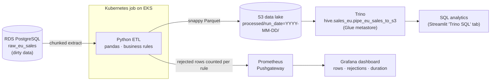
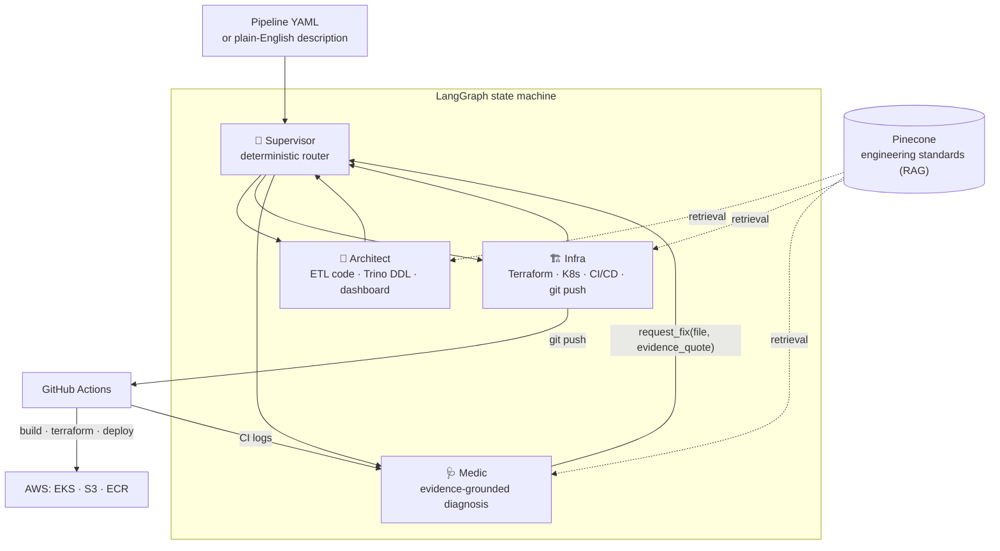
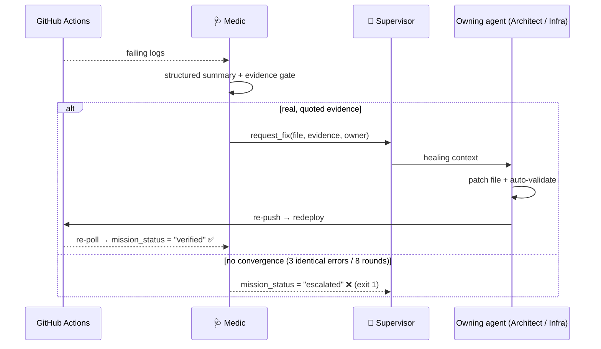

# Self-Healing Big Data Pipeline on AWS

**Big Data mini project.** A team of AI agents builds a batch Big Data pipeline on AWS, deploys it, and repairs it when the deployment fails.

| | |
|---|---|
| **Team** | _Member 1_ · _Member 2_ · _Member 3_ |
| **Subject** | Big Data Analytics — mini project |
| **Stack** | Python · pandas · PyArrow/Parquet · PostgreSQL (RDS) · Amazon S3 · Trino · Prometheus + Grafana · Kubernetes (EKS) · Terraform · GitHub Actions · LangGraph |

---

## 1. Problem statement

Building a data pipeline takes many separate pieces of work: ETL code, a storage layout, a SQL catalog, infrastructure, CI/CD, and monitoring. Pipelines also break, usually because of dirty source data or a configuration mistake, and someone has to read the logs and fix them.

This project automates both parts:

1. **Build.** Starting from a YAML config (or a plain-English description), agents generate a working batch pipeline:
   - extract sales orders from **PostgreSQL**
   - apply **data-quality rules**
   - write **Parquet partitioned by `run_date`** to an **S3 data lake**
   - register the data as a **Trino** table for SQL analytics
   - publish run metrics to **Grafana**
2. **Self-heal.** When the deployment fails, a *Medic* agent reads the real CI logs, finds the faulty file using quoted evidence, sends the problem to the agent that owns that file, patches it, and redeploys.

## 2. Big Data pipeline (what gets built)



| Big Data concept | How it is implemented |
|---|---|
| **Ingestion** | Chunked SQLAlchemy reads from RDS PostgreSQL. The whole table is never loaded into memory at once. |
| **Data quality / cleansing** | Six rules in [`configs/business_rules/sales_logic.yaml`](configs/business_rules/sales_logic.yaml), compiled into real pandas conditions (see §3) |
| **Columnar storage** | Apache **Parquet** with **snappy** compression (PyArrow + s3fs) |
| **Partitioning** | Hive-style `s3://eu-sales-insights-data/processed/run_date=<date>/` |
| **Idempotency** | If today's `run_date` partition already exists, the job exits without rewriting it |
| **Schema-on-read / SQL engine** | Trino external table over S3 (`sql/setup_trino.sql`) with the Glue metastore. The partitions are synced, so a filter on `run_date` only scans the matching S3 prefixes (partition pruning). |
| **Observability** | The job pushes `rows_processed`, `rows_rejected` (per rule) and `duration_seconds` to Prometheus Pushgateway. A Grafana dashboard plus a 60-minute *data silence* alert are generated with the pipeline. |
| **Infrastructure as code** | Terraform for the S3 bucket and IAM (IRSA). Kubernetes manifests for Trino, Grafana, Prometheus and the pipeline Job. |

The generated artifacts land in the repo under `scripts/`, `sql/`, `dashboards/`, `k8s/`, `terraform/`, `Dockerfile` and `.github/workflows/pipe_*.yml`. Snapshots of the deterministic artifacts are pinned as test goldens in [`tests/goldens/aws/`](tests/goldens/aws/).

## 3. Data-quality rules

The source table is deliberately polluted by [`scripts/seed_chaos.py`](scripts/seed_chaos.py) with negative prices, NULL quantities, future dates and unknown currencies. Each row is then checked against these rules:

| Rule | Target | Logic | On failure |
|---|---|---|---|
| `monetary_integrity` | price / amount / cost columns | value > 0 | `DROP_RECORD` |
| `temporal_validity` | order date | ≤ now | `EXCLUDE_AND_LOG` |
| `completeness_enforcement` | `order_id` | not NULL / empty | `DROP_RECORD` |
| `currency_standardization` | `currency` | ∈ {EUR, GBP} | `DEFAULT_VALUE` → `EUR` |
| `volume_sanity_check` | `quantity` | < 1000 | `FLAG_AS_SUSPICIOUS` |
| `quantity_validity` | `quantity` | > 0 | `FLAG_AS_SUSPICIOUS` |

Rejection counts per rule are exported as metrics, so data quality shows up in Grafana.

## 4. The agents and the self-healing loop



- **Supervisor**: a deterministic router. The routing rules are Python code, not prompt text.
- **Architect**: generates the parts that need judgment: the ETL script and the Trino DDL. It first inspects the real source schema, then writes code that follows the standards it retrieves from the knowledge base ([`knowledge_base/`](knowledge_base/)).
- **Infra**: generates the pipeline Terraform. The Dockerfile, Kubernetes manifests and deploy workflow are rendered deterministically from config by [`agents/codegen.py`](agents/codegen.py). It then pushes everything and triggers CI.
- **Medic**: polls the CI run and turns the failure into a structured summary. It may only call `request_fix` with a **verbatim quote** from real log output. Speculation is rejected, which acts as an anti-hallucination gate. The quoted file is then patched surgically.



Safety limits:
- **Bounded:** the healing loop stops after 3 identical errors or 8 rounds.
- **Fail-closed:** a run counts as successful only when its status is `verified`.
- **Pre-push security gate:** before every push, [`policy/security_analyzer.py`](policy/security_analyzer.py) blocks generated bundles that contain:
  - containers running as root
  - inline secrets
  - public buckets or databases
  - wildcard IAM
  - unpinned GitHub Actions

## 5. Repository layout

| Path | Contents |
|---|---|
| `agents/`, `graph.py`, `main.py` | The multi-agent system (LangGraph nodes, tools, prompts, deterministic codegen) |
| `configs/` | The `eu_sales` pipeline: objective, source DB, business rules, S3 target |
| `knowledge_base/` | Engineering standards used for RAG (Python, SQL, Grafana, CI/CD, Terraform-S3, Docker, K8s) |
| `bootstrap/aws/` | One-time baseline Terraform: EKS, RDS PostgreSQL, ECR, S3 state, SSM parameters |
| `scripts/` | `seed_chaos.py` (dirty data), `ingest_to_pinecone.py` (RAG sync), `export_bootstrap_outputs.py` |
| `utils/` | Config/credential resolution, rules loader, Trino client, observability, NL parser, cost estimate |
| `streamlit_app.py` | Web UI: describe a pipeline in plain English, upload a dataset, run the sample pipeline, query Trino, view metrics |
| `evals/` | Offline self-heal eval: a corpus of 10 real failure classes scored against the real Medic routing + evidence gate |
| `policy/` | Security gate for generated infrastructure + unsafe test fixtures |
| `tests/` | Hermetic unit tests (no cloud, no credentials) |

## 6. How to run

**Prerequisites:**
- Python 3.12+ and [uv](https://docs.astral.sh/uv/)
- Terraform ≥ 1.6 and the AWS CLI
- an OpenAI API key and a Pinecone index (dimension 1536, cosine)
- an AWS account
- a GitHub token with `repo` and `workflow` scopes

```bash
cp .env.example .env      # fill in keys
make install              # uv sync
make bootstrap-aws        # one-time: EKS + RDS + ECR + S3 state + SSM (exports outputs)
make demo                 # ingest standards → seed 100 dirty rows → run the eu_sales pipeline
```

Or run each step yourself:

```bash
make ingest               # sync knowledge_base/ to Pinecone
make chaos rows=200       # seed dirty rows into raw_eu_sales
make run p=eu_sales       # agents build, deploy and (if needed) heal the pipeline
make streamlit            # web UI on http://localhost:8501
```

The same steps are available from GitHub Actions in `run_agent.yml` (manual dispatch with bootstrap, knowledge-base sync, chaos and pipeline inputs).

> **Cost warning.** The AWS baseline (EKS + RDS) bills by the hour, about $230/month while running (`make cost`). Use `make aws-pause` between sessions and `make aws-resume` before a demo. Tear everything down with `make destroy-aws` or the `destroy.yml` workflow after the evaluation.

**Querying the data lake:**

```bash
kubectl port-forward svc/trino 8080:8080 -n analytics   # then TRINO_HOST=localhost in .env
```

```sql
SELECT run_date, currency, COUNT(*) AS orders, ROUND(SUM(unit_price * quantity), 2) AS revenue
FROM hive.sales_eu.pipe_eu_sales_to_s3
WHERE run_date >= DATE '2026-05-01'          -- partition pruning
GROUP BY run_date, currency
ORDER BY run_date DESC;
```

## 7. Self-healing demo (for the viva)

1. Run `make chaos` to load dirty data, then `make run p=eu_sales`.
2. Watch the log, or the **Agent graph** in Streamlit. The Architect generates the ETL, and `validate_generated_code` checks it.
3. If the deploy fails, the Medic quotes the failing line from the CI log, for example:

   ```
   ValueError: could not convert string to float: 'not_a_number'
   ```

   It routes the fix to the Architect, which patches the file (for example `.astype(float)` → `pd.to_numeric(..., errors="coerce")`). Then the run redeploys.
4. The run ends with `✅ MISSION VERIFIED`. The S3 bucket now contains `run_date=…/` Parquet files, Trino can query them, and the Grafana dashboard shows rows processed vs rejected.
5. To show the Medic's routing without any cloud, run `make heal LOG=<some_failing_log>.txt`.

## 8. Testing and evaluation

```bash
make test          # hermetic unit tests — no cloud, no credentials
make lint          # ruff
make eval-replay   # offline self-heal eval → evals/report/REPORT.md
make gate-proof    # security gate refuses unsafe fixtures, passes the AWS goldens
```

The test suite covers:
- supervisor routing
- the generated-code validators
- golden-file tests for every deterministic artifact (Dockerfile, K8s manifests, Grafana dashboard, deploy workflow)
- credential resolution
- the state lifecycle

The eval harness replays 10 failure cases (script bugs, Trino DDL errors, S3/IAM and SSM failures, and hallucination traps) against the real Medic routing and evidence gate. Both currently score 100%.

## 9. Limitations and future work

- **Batch only:** no streaming ingestion (Kafka/Kinesis would be the next step).
- **Single-node processing:** the ETL uses pandas, so very large volumes would need Spark (EMR) or pushing transforms into Trino.
- **Demo-grade networking:** the RDS endpoint is public but restricted to allow-listed IP ranges (CIDR), and Grafana is on a password-protected public load balancer. Trino is internal-only and has no authentication.
- **The LLM is not unit-tested:** generated-code quality is checked by the validators, the eval harness and real runs, not by asserting on model output.

## Credits and license

This project is a scoped-down, AWS-only adaptation of [`self-healing-multi-cloud-agents`](https://github.com/theofanis-tsakanikas/self-healing-multi-cloud-agents). MIT License, see [LICENSE](LICENSE). Architecture details are in [docs/ARCHITECTURE.md](docs/ARCHITECTURE.md).
